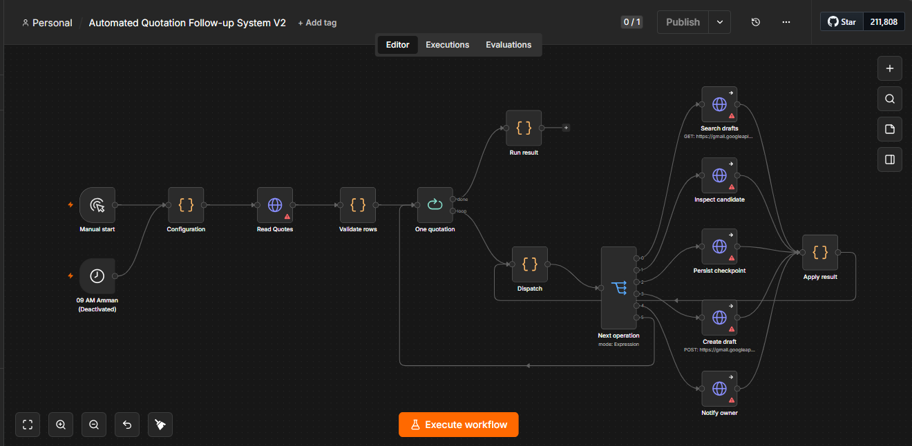

# Automated Quotation Follow-up System V2

An importable n8n workflow for a sales team that tracks quotations in a Google Sheet. It prepares one follow-up draft for a due quotation and optionally alerts the **owner** through WhatsApp. A salesperson reviews and sends the email separately.

**Delivery status.** The export is inactive. Its daily trigger is disabled, the live-access guard is closed and WhatsApp is off. Validated with the n8n 2.20.0 CLI and local HTTP fixtures, plus 20 offline regression tests. The released configuration stops before network access. The engine suite runs a separate copy against loopback services. See [TESTS.md](TESTS.md) for results and limits.

## Workflow Overview



The screenshot shows a local V2 import. Red warning triangles indicate unconfigured credentials. The final export is distributed in this repository. Execution evidence comes from [the test report](TESTS.md).

## Try the offline suite

From the extracted repository root, using Node.js 22 or later:

```sh
node --test tests/workflow.test.cjs
```

No npm install, credentials, spreadsheet, mailbox or WhatsApp account is needed. The audit is in AUDIT.md. TESTS.md lists the executed checks and outstanding integration checks.

## Run the real-engine regression suite

On a machine with Python 3.10+ and the n8n CLI on PATH, run:

```sh
python3 tests/engine.py
```

The Python driver creates a temporary n8n user folder with its own SQLite database. It imports the release, checks the live-access guard, then imports a test copy whose six HTTP nodes use the local fixture server. No personal OAuth account, email, provider token, or running editor is needed. TCP ports 15678 and 15789 must be available. The fixture server takes a free loopback port. Use the default internal JavaScript task runner. The test exits nonzero on a failed assertion. The release workflow carries a public workflow ID for CLI import; CLI imports into an existing database can replace a workflow with the same ID. Use a fresh database for CLI tests.

## Private setup

1. Import **Automated-Quotation-Follow-up-V2.json** into a new workflow using the workflow menu's **Import from File**. Keep the schedule disabled and the workflow unpublished. Use an n8n installation with Code v2, HTTP Request v4.2, Switch v3.2 and Loop Over Items v3. Never commit an export of a configured private copy without reviewing it for account identifiers.
2. Create a private copy of the spreadsheet with a tab named exactly **Quotes**. Paste the tab-separated line below into A1. Preserve field order. Extra columns from M onward are ignored. Format quote IDs as plain text and display follow-up dates as yyyy-mm-dd. Each quotation requires one stable ID. Use 1–80 ASCII letters, digits, periods, underscores or hyphens, starting with a letter or digit. Case-only duplicates are held.
3. Enable the Google Sheets and Gmail APIs for the relevant OAuth clients. In **Read Quotes** and **Persist checkpoint**, select a Google Sheets OAuth2 credential with read/write access to that sheet. In **Search drafts**, **Inspect candidate** and **Create draft**, select the same Gmail OAuth2 credential. It must support draft creation, search and reading message headers (e.g. gmail.modify). Use one dedicated mailbox and one workflow writer for this sheet.
4. In **Configuration**, enter the spreadsheet ID. Leave WhatsApp disabled to work on drafts independently. If owner alerts are authorized later, configure the Graph API version supported by your app, the sender phone number ID and the owner's international phone number as digits. In **Notify owner**, bind a private Header Auth credential with header name `Authorization` and value `Bearer <token>`. The secret belongs only in the credential store.
5. For a scheduled business-initiated alert, set `templateName` and `templateLanguage` to an approved WhatsApp template with exactly three positional body text parameters (quote ID, customer name, amount), and no required header or button parameters. Example body for template approval: “Quotation {{1}} for {{2}} is ready for review. Amount: {{3}}.” Leaving the template blank uses free-form text, which requires an open customer-service window. Configure the owner as an eligible recipient.
6. Complete the migration review below. Change `live` to true **only when intentionally authorizing external writes**. Manual execution with this flag can create real Gmail drafts and update the spreadsheet. Enabling `whatsappEnabled` also permits owner notifications for the entire queued backlog. For review or testing, use the offline command above.
7. After separate approval, scheduling requires enabling **09 AM Amman** and activating/publishing the private workflow. Both its daily 09:00 trigger and its due-date calculation use Asia/Amman. Keep manual runs, other writers and V1 from overlapping a scheduled run.

### Sheet contract

```tsv
quote_id	customer_name	customer_email	amount	follow_up_date	status	draft_id	alert_status	error_message	draft_guard	alert_attempts	wa_message_id
```

| Columns | Contents |
| --- | --- |
| A–E | Quote ID, customer name, one plain email address, display amount, ISO follow-up day. Amount is copied into the alert as displayed. New pending rows require a name and supported ASCII email address. |
| F | Start with Pending. V2 writes Draft Created. Closed, Cancelled/Canceled, Accepted, Rejected, Sent, Won and Lost are terminal (case-insensitive). Unrecognized states require review. |
| G | Gmail **draft resource** ID. Keep this even after a salesperson sends the draft. |
| H–I | Owner alert state and latest diagnostic. |
| J | Reserved while a create request may have taken effect. |
| K–L | Count of claimed alert attempts and WhatsApp provider message ID. |

For a new quote, leave G–L empty. On a fresh run, the workflow snapshots A:L, checks headers and duplicate keys, and processes one row at a time. **Keep row positions stable until the run finishes.** Sorting, inserting or deleting rows, changing quote identity, or running overlapping copies can invalidate the snapshot. Protected sheet access or a dedicated automation tab helps enforce this operating model. Sheets supplies no compare-and-swap lock here.

### Migrating an existing V1 sheet

Work on a copy. Confirm A–I match the header, then add J–L. Keep genuine existing draft IDs and Sent markers. Reconcile V1 rows with blank or Retry alerts against the owner's notification history before enabling WhatsApp. An explicit Retry authorizes another send. A blank alert on a recorded draft stays held. For historical pending rows whose Gmail outcome is uncertain, set J to Reserved before first use. V2 can then search without authorizing a new draft. Check already sent, moved, renamed or deleted drafts manually. Keep the original QFUP subject and recipient stable for recovery.

## Operating and recovering

| Observable state | What the next full run does | Operator action |
| --- | --- | --- |
| Due Pending, no guard | Searches Gmail. A single exact draft is adopted. Zero candidates permits a durable reservation followed by one create. | Review collisions or mismatches reported in I. |
| Reserved | Searches again. When one candidate's draft ID, complete subject and sole To recipient verify, it writes that draft's ID and queues the alert. Empty or ambiguous searches keep the guard. | Check Gmail drafts, sent mail and execution history. Clear J only after establishing that a new draft is appropriate. |
| Draft Created / Queued | Attempts the alert when WhatsApp is enabled. It persists Sending before calling Meta. | Expect Queued to accumulate while alerts are disabled. |
| Retry | Retries an explicit rate-limit rejection on a subsequent execution (normally the next day), up to three claimed attempts. | Avoid repeated manual runs. Review after the cap. |
| Auth Blocked | Holds the affected row. | Code 190 or HTTP 401 requires fixing the credential. When ready, set H to Retry. Preserve K unless explicitly granting a fresh attempt budget. Other queued rows can independently encounter the same credential error. |
| Sending / Review | Holds an interrupted, uncertain or rejected request. | Reconcile with the owner/provider. Mark confirmed acceptance as Accepted, or explicitly set Retry if appropriate. If L already contains a provider ID, investigate before requeueing. |
| Accepted / legacy Sent | Skips further sends. Accepted records Meta's response with a message ID. | Actual delivery requires separate webhook confirmation. |
| Sheet-write error | Completes other rows where possible, then fails the run summary. | Read the failed execution, verify the affected sheet row and start a **fresh full run**. Never replay a create/send node or resume midway using old node inputs. |

A batch of up to two Gmail candidates is sufficient to decide whether automatic adoption is safe. A next-page token or more than one result holds the row. Gmail's search narrows the candidates; header inspection verifies ownership. A newly created draft becomes eligible for an alert only after Sheets confirms the draft checkpoint. An empty sheet (header only) produces no work.

## References

- [n8n workflow import and export](https://docs.n8n.io/workflows/export-import/)
- [n8n item linking in the Code node](https://docs.n8n.io/data/data-mapping/data-item-linking/item-linking-code-node/)
- [Gmail draft search](https://developers.google.com/workspace/gmail/api/reference/rest/v1/users.drafts/list) and [draft retrieval](https://developers.google.com/workspace/gmail/api/reference/rest/v1/users.drafts/get)
- [Google Sheets batch value updates](https://developers.google.com/workspace/sheets/api/reference/rest/v4/spreadsheets.values/batchUpdate)
- [WhatsApp Cloud API errors](https://developers.facebook.com/docs/whatsapp/cloud-api/support/error-codes/)
